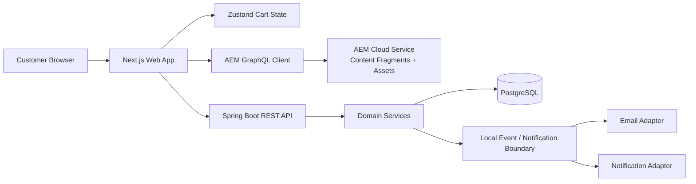
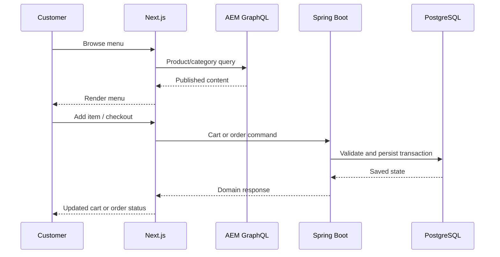
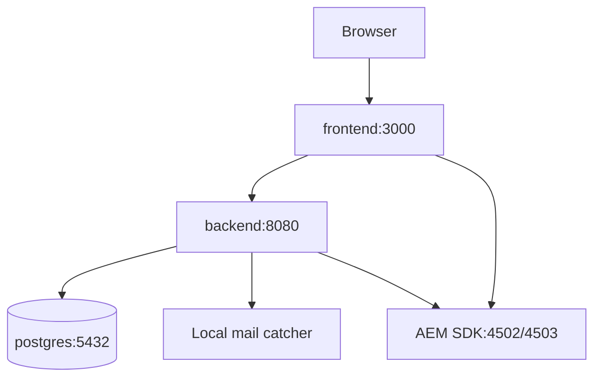

# System Architecture

## Design Principles

- AEM is the source of truth for editorial menu and campaign content.
- Spring Boot is the source of truth for transactional state.
- GraphQL is used for content-shaped reads; REST is used for domain commands.
- Services remain independently testable while Docker Compose supplies a local system boundary.
- Secrets, credentials, and environment-specific endpoints are injected at runtime.
- Failures are explicit, observable, retryable where safe, and idempotent where required.

## Logical Architecture

## Frontend Layer

### Next.js

Owns routing, server-rendered product reads, request boundaries, metadata, caching policy, error/loading states, and progressively enhanced checkout pages. The frontend must never expose privileged AEM credentials to the browser.

### React

Owns composable UI, accessible interaction states, forms, product customization, cart presentation, and checkout feedback. Components should be small, typed, and testable without requiring a running AEM instance.

### Zustand

Owns cart and transient customer interaction state. Server-confirmed cart totals and order status remain authoritative in backend responses. Persist only non-sensitive, recoverable state such as an anonymous cart identifier.

## CMS Layer

### AEM Cloud Service

Stores authored menu, category, offer, store, and campaign content. Content Fragment Models enforce required fields, validation, naming, references, publishing workflow, and editorial governance.

### Content Fragments

Represent structured products, categories, offers, stores, and future editorial user-facing content. Assets are referenced through AEM-managed media paths with renditions appropriate for responsive delivery.

### GraphQL

Provides allow-listed, read-oriented queries for product, category, and offer retrieval. Query depth, result size, persisted query usage, cache headers, and publication state must be governed before production exposure.

## Backend Layer

### Spring Boot

Provides REST APIs for carts, users, stores, orders, coupons, and notifications. It validates commands, applies business rules, stores transactional state, and coordinates content enrichment without making AEM the owner of order data.

### PostgreSQL

Stores normalized domain entities, immutable order snapshots, status transitions, audit timestamps, idempotency keys, and indexes for customer and store workflows. Schema migrations are versioned and tested.

## Future Integrations

| Integration | Boundary | Initial approach |
|---|---|---|
| Payments | Payment provider adapter | Sandbox contract and fake provider |
| Authentication | Identity provider adapter | Guest flow first; OIDC-ready API |
| Email | Notification adapter | Local mail catcher and template events |
| Notifications | Event-driven adapter | In-process event contract, then provider integration |

## Request Flow

## Local Deployment Topology

## Cross-Cutting Requirements

- Correlation ID on every frontend-to-backend request.
- Structured JSON logs in backend services.
- Health, readiness, and dependency checks for local containers.
- Timeouts and bounded retries for AEM and external adapters.
- Request validation at every public API boundary.
- Explicit currency, timezone, locale, and rounding policies.
- Documented API versioning and backward compatibility rules.
