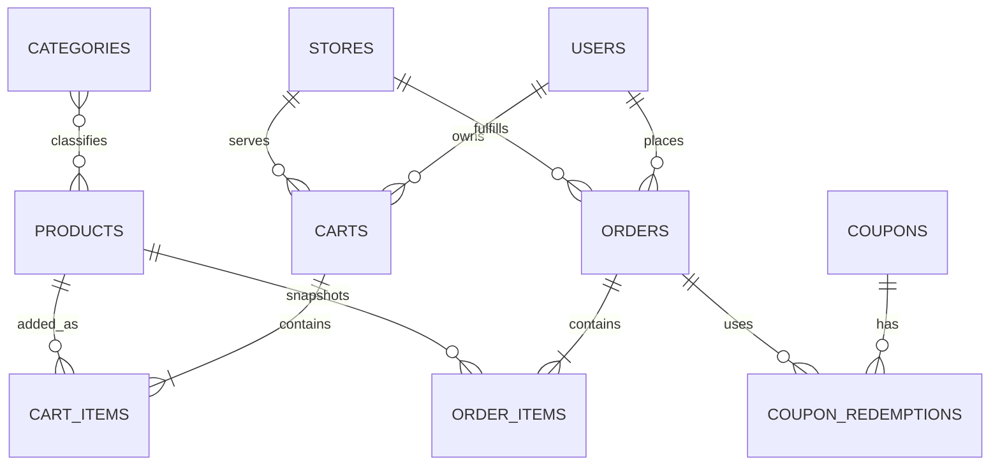

# PostgreSQL Database Design

## Database Standards

Use PostgreSQL with UTC timestamps, UUID primary keys for internal entities, human-readable display numbers only where customer-facing, forward-only migrations, foreign keys, check constraints, and indexes based on measured query plans. Financial values use integer minor units or a fixed-precision numeric policy decided before implementation; do not use floating point.

## Core Tables

### Users

`id UUID PK`, `external_subject VARCHAR UNIQUE NULL`, `email CITEXT UNIQUE NULL`, `display_name VARCHAR(120)`, `preferred_locale VARCHAR(20)`, `marketing_consent BOOLEAN NOT NULL`, `consent_recorded_at TIMESTAMPTZ NULL`, `created_at`, `updated_at`, `deleted_at NULL`.

### Categories

`id UUID PK`, `aem_path VARCHAR UNIQUE`, `slug VARCHAR NOT NULL`, `title VARCHAR(80) NOT NULL`, `locale VARCHAR(20) NOT NULL`, `display_order INTEGER CHECK >= 0`, `is_active BOOLEAN NOT NULL`, `synced_at TIMESTAMPTZ NOT NULL`. Unique constraint on `(slug, locale)`.

### Products

`id UUID PK`, `sku VARCHAR UNIQUE NOT NULL`, `aem_path VARCHAR UNIQUE`, `title VARCHAR(160) NOT NULL`, `description TEXT`, `price_minor BIGINT CHECK >= 0`, `currency CHAR(3)`, `is_veg BOOLEAN NOT NULL`, `availability VARCHAR(24)`, `is_active BOOLEAN NOT NULL`, `content_version VARCHAR`, `synced_at TIMESTAMPTZ NOT NULL`.

### Cart

`id UUID PK`, `user_id UUID FK NULL`, `guest_token_hash VARCHAR UNIQUE NULL`, `store_id UUID FK NULL`, `status VARCHAR(24)`, `currency CHAR(3)`, `expires_at TIMESTAMPTZ`, `created_at`, `updated_at`. Index active carts by user and expiry.

### CartItems

`id UUID PK`, `cart_id UUID FK`, `product_id UUID FK`, `sku_snapshot VARCHAR`, `title_snapshot VARCHAR`, `unit_price_minor BIGINT`, `quantity INTEGER CHECK > 0`, `customization JSONB NULL`, `created_at`, `updated_at`. Unique `(cart_id, product_id, customization_hash)` as appropriate.

### Orders

`id UUID PK`, `display_number VARCHAR UNIQUE`, `user_id UUID FK NULL`, `guest_reference_hash VARCHAR NULL`, `store_id UUID FK`, `status VARCHAR(32)`, `currency CHAR(3)`, `subtotal_minor BIGINT`, `discount_minor BIGINT`, `tax_minor BIGINT`, `delivery_fee_minor BIGINT`, `total_minor BIGINT`, `idempotency_key VARCHAR UNIQUE`, `placed_at TIMESTAMPTZ`, `created_at`, `updated_at`.

### OrderItems

`id UUID PK`, `order_id UUID FK`, `product_id UUID FK NULL`, `sku_snapshot VARCHAR`, `title_snapshot VARCHAR`, `unit_price_minor BIGINT`, `quantity INTEGER`, `line_total_minor BIGINT`, `customization JSONB NULL`. Product FK is nullable because historical orders must survive catalog deletion.

### Stores

`id UUID PK`, `store_code VARCHAR UNIQUE`, `aem_path VARCHAR UNIQUE NULL`, `name VARCHAR`, `address JSONB`, `latitude NUMERIC`, `longitude NUMERIC`, `timezone VARCHAR`, `is_active BOOLEAN`, `temporary_closure BOOLEAN`, `created_at`, `updated_at`.

### Coupons

`id UUID PK`, `code VARCHAR UNIQUE`, `title VARCHAR`, `type VARCHAR(24)`, `value_minor BIGINT`, `minimum_subtotal_minor BIGINT`, `starts_at TIMESTAMPTZ`, `ends_at TIMESTAMPTZ`, `max_redemptions INTEGER NULL`, `is_active BOOLEAN`, `created_at`, `updated_at`.

## Supporting Tables

- `order_status_history`: immutable status transitions with actor, reason, and timestamp.
- `coupon_redemptions`: unique coupon/order/user combination and redemption state.
- `store_hours`: weekday and exception hours in store timezone.
- `store_closures`: temporary closure reason and validity window.
- `idempotency_keys`: request fingerprint, owner, status, response reference, and expiry.
- `outbox_events`: committed events waiting for notification or integration delivery.
- `schema_migrations`: managed by the chosen migration tool.

## Relationships

## Integrity Rules

- An order cannot be placed against an inactive or closed store.
- Order totals equal the sum of persisted lines plus tax and fees minus discounts.
- A cart item quantity is positive and bounded by a configured maximum.
- Coupon redemption is protected by a unique constraint and transaction lock.
- Order status changes are validated against an allowed transition table.
- Deleted users are anonymized or soft-deleted according to retention policy.
- Historical order snapshots never depend on mutable product titles or prices.

## Index Plan

Index active products by category and display order; carts by user, guest token hash, and expiry; orders by user and created time, store and status, and display number; coupon codes and active date windows; outbox events by status and next-attempt time. Validate every index with `EXPLAIN (ANALYZE, BUFFERS)` on representative data.

## Migration and Backup Plan

Every schema change has a reviewed migration, rollback or forward-repair strategy, data backfill plan, and verification query. Local development uses disposable volumes; release environments require tested backups, restore drills, retention rules, and encrypted storage.
