# CI/CD Strategy

## Local-First Policy

The primary development and deployment target is a reproducible local environment. The project must not require AWS, Azure, or another third-party cloud to build, test, or demonstrate the platform. GitHub hosts source and workflow definitions; GitHub Actions provides automation; Docker packages repeatable services; Docker Compose runs the stack locally.

## Local Environments

- `compose.dev.yml`: frontend, backend, PostgreSQL, mail catcher, and supporting tools.
- `compose.test.yml`: isolated dependencies, seeded fixtures, and ephemeral test volumes.
- AEM SDK runs locally using the Maven project and documented author/publish ports.
- `.env.example` documents non-secret defaults and required local variables.
- Secrets are supplied through local environment variables or a developer secret store, never committed.

## CI Strategy

### PR Validation

1. Check out the repository with a pinned toolchain.
2. Validate Markdown links, Mermaid fences, and repository conventions.
3. Install frontend dependencies from the lockfile.
4. Run frontend lint, typecheck, unit tests, and production build.
5. Run backend compile, unit tests, integration tests with Testcontainers, and static analysis.
6. Build AEM modules with Maven and execute AEM unit tests.
7. Run GraphQL contract tests against fixtures or a local AEM endpoint.
8. Run dependency, secret, license, and container security scans.
9. Upload test reports and build artifacts.

### Build

Build immutable frontend and backend artifacts from the commit SHA. Build the AEM package with Maven. Record versions, dependency lockfiles, image digests, test summaries, and provenance metadata.

### Unit Tests

Run frontend component and state tests, backend service and controller tests, and AEM model/service tests. Fail the workflow on new failures or unapproved coverage regressions.

### Lint

Run ESLint and TypeScript checks for frontend code, Java formatting/static analysis for backend code, Maven checks for AEM modules, and Markdown validation for docs.

### Security Scan

Run secret scanning, dependency vulnerability scanning, SAST, container image scanning, and IaC/configuration checks. High and critical findings block release unless formally risk-accepted.

## CD Strategy

### Auto Build

On merge to the protected main branch, repeat the release-grade build from a clean runner and produce versioned artifacts.

### Docker Image Generation

Build backend and any supporting service images with non-root users, minimal runtime layers, pinned base image versions, health checks, labels, SBOM output, and immutable commit tags.

### Local Deployment

Publish artifacts to the local Docker environment or load them into Docker Compose. Run smoke tests against frontend, backend, PostgreSQL, and AEM SDK. Deployment output must include the local URLs, image tags, migration result, and smoke-test summary.

## Workflow Architecture

```mermaid
flowchart LR
    PR[Pull Request] --> Validate[Validate + Lint]
    Validate --> Unit[Unit Tests]
    Unit --> Integration[Integration + Contract Tests]
    Integration --> Security[Security Scans]
    Security --> Review[Required Review]
    Review --> Merge[Merge to Main]
    Merge --> Build[Build Artifacts]
    Build --> Images[Build Docker Images]
    Images --> Compose[Deploy Local Compose]
    Compose --> Smoke[Smoke Tests]
    Smoke --> Report[Publish Reports + SBOM]
```

## Branch and Promotion Rules

Protect `main`, require passing status checks, require at least one review, prohibit direct pushes, and use short-lived branches. Release tags are created only after the release checklist passes. The repository may later connect AEM artifacts to Adobe Cloud Manager, but that is separate from the local-first application delivery path.

## Quality Gates

- No build warnings treated as errors without a documented exception.
- No secrets in source, artifacts, logs, or test reports.
- API and schema changes include compatibility tests.
- Migrations are tested from an empty database and an upgrade fixture.
- Smoke tests cover menu read, cart mutation, checkout validation, and service health.
